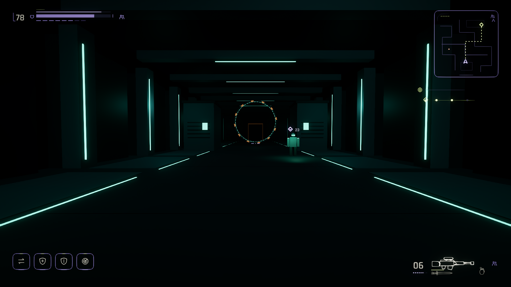

# SenseLink UI delivery

- UI assets: `Assets/garam/UI/` (scene, Canvas prefab, shaders, fonts, materials, runtime and editor code).
- Shared design source: `Design/hud-layout.json`; generator: `tools/generate-hud-layout.mjs`.
- Design: [Figma](https://www.figma.com/design/XRi3tZ8GwuovH3Jt4qKWHV/UnityAIGameJam2026?node-id=9-577).
- Revision 7: lavender, ivory and lime; compact four-corner layout; numeric text only; frameless weapon silhouettes.

## Validation

Validated in Unity 6000.3.28f1 / URP 17.3.

- Recompiled after relocation to `Assets/garam/UI`: zero errors and warnings.
- Canvas/font references, ownership, consent, objective gate, critical threshold and awakening: PASS (176 native UGUI Graphics).
- Revision 7 UGUI raycast and pointer interaction checks: PASS after relocation.
- Scene/prefab and supporting assets retain their original GUIDs. Delivery files match the validated working copy byte for byte.
- UnityPackage exported from the relocated assets. Generated packages/captures remain ignored; source assets and this preview are versioned.
- Source-code whitespace checks pass; Unity-generated YAML/meta files retain Unity serializer whitespace.
- Physical mouse/keyboard input and a separate player build were not revalidated.

## Branch base

This branch carries the tested URP UI sample from the original UI workspace. `origin/main` has subsequently moved to HDRP 17.3. HDRP integration of the showcase materials, volume effects and rendering-specific code is a separate follow-up; merging this branch does not establish HDRP compatibility.
