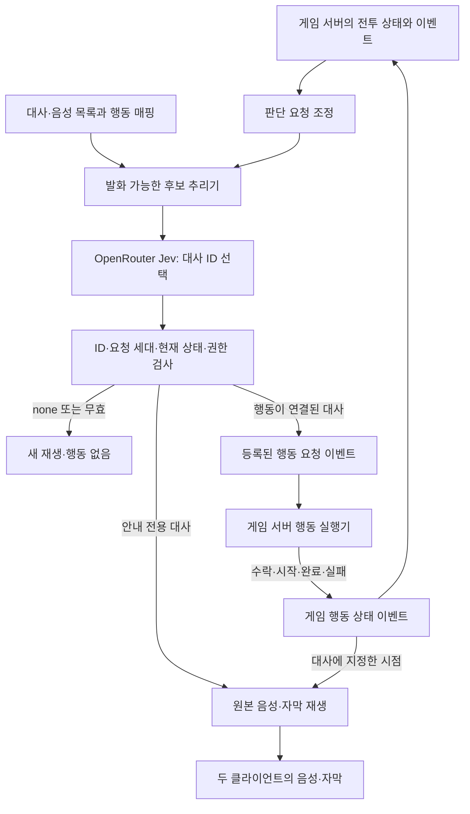

# ON YOUR MARK — Jev 대사 선택과 행동 이벤트 아키텍처

작성일: 2026-11-18

## 1. 목표와 현재 상태

미리 제작한 **대사 텍스트 + 음성 파일** 목록에서 Jev가 상황에 맞는 대사 ID를 고른다. 게임은 선택된 ID로 원본 음성을 재생하고, 해당 대사에 행동이 등록되어 있으면 게임 이벤트를 통해 실행한다. 실시간 문장 생성과 TTS를 생략해 대사·목소리를 통제하고 응답 지연을 줄인다.

|항목|상태|
|---|---|
|사전 제작 영어 음성 33개와 한국어 번역 연결|웹 데모 구현·재생 검증 완료|
|Jev의 대사 선택, 무음 선택, 신뢰도 표시|실제 API 검증 완료|
|대사 목록 미리 듣기, 정지, 오래된 결과 폐기|웹 데모 구현·검증 완료|
|특정 대사 ID와 실제 게임 행동의 연결|이 문서의 확장 설계, Unity 구현 전|
|Unity의 권한 검사·이동·회복·재장전·소생·네트워크 동기화|구현·플레이 검증 전|
|약 100개의 대사 라이브러리|추후 확장, 현재는 합의한 33개 사용|

이번 브랜치의 산출물은 이 설계 문서다. 현재 웹 실험 코드는 로컬 작업 공간의 `tools/voice-lab/`에 있으며 이 문서 커밋에 포함하지 않는다. 게임 구현은 아래 계약과 완료 조건을 기준으로 진행한다.

## 2. 전체 흐름



Jev는 목록에서 **대사 ID 하나**를 선택한다. 행동 종류, 실행 주체, 대상, 수치와 실행 시점은 게임이 소유한 매핑으로 결정한다. 선택 응답의 임의 문자열을 함수 이름이나 파일 경로로 실행하지 않는다.

음성 재생과 게임 행동은 같은 `decision_id`에서 파생된다. 음성 플레이어의 `Play()`나 재생 완료 콜백으로 게임 행동을 발동시키지 않는다. 미리 듣기·재생 재시도·네트워크 중복 수신으로 행동이 반복되는 것을 방지하기 위한 구분이다.

## 3. 대사 라이브러리

현재 팩은 `lines.csv`와 영어 WAV 33개다. 한국어 열은 자막용 번역이다. 톤 참고용 `ref_shout`, `ref_firm`, `ref_calm`은 선택 대상에서 제외한다. WAV와 MP3를 모두 지원하고 기존 WAV를 그대로 사용한다.

현재 CSV의 필드는 `id`, `file`, `english`, `korean`, `category`, `tone`, `seconds`다. 실행 시 ID로만 음성을 찾으며, 목록 밖 ID·누락된 파일·허용 폴더를 벗어난 경로는 거부한다. 이 팩은 동료 캐릭터의 영어 구어체이므로 기존 M.A.R.K. 무전 생성 모드의 35자·보고체 제한과는 별도다.

게임 연동 시에는 대사 목록과 별도로 **행동 매핑**을 둔다. Unity에서는 대사 목록을 ScriptableObject 또는 빌드에 포함하는 데이터 파일로 가져오고, 행동 매핑의 `action_id`를 등록된 실행기에 연결한다. 아래는 제안 데이터 형식이며 아직 웹 데모의 CSV 필드는 아니다.

```json
{
  "catalog_version": "coop-callouts-v1",
  "clip_id": "ammo_empty",
  "audio_key": "coop/09_ammo_empty",
  "text_en": "Your mag's empty! Reload, reload!",
  "text_ko": "탄창 비었어! 장전, 장전!",
  "intent": "reload_recipient",
  "action_binding": {
    "action_id": "ReloadWeapon",
    "actor_ref": "recipient",
    "target_ref": "actor",
    "speech_phase": "action_accepted"
  }
}
```

`action_binding`이 없으면 안내 전용이다. `actor_ref`와 `target_ref`는 `speaker`, `recipient`, `actor` 같은 정해진 참조만 허용한다. 실제 플레이어·AI 엔티티 ID는 서버가 현재 세션에서 해석한다. `catalog_version`으로 클라이언트 음성과 서버 매핑의 버전이 같은지 확인한다.

현재 대사에는 HUD 복구 축하 문구가 없다. 해당 상황은 `none`을 선택하며, 그 상황을 지원하려면 먼저 맞는 텍스트·녹음을 추가한다. 100개로 확장할 때도 고유 ID와 실제 녹음이 있는 항목만 등록한다. 같은 녹음을 복제해 개수만 늘리지 않는다.

## 4. Jev의 역할과 입력·출력

OpenRouter의 **System One API** `POST /api/v1/systemone`을 사용한다. 요청 모델은 `jev-latest`이며, 2026-11-18 실제 응답 모델은 `typesafe/jev-1.14-20261014`였다. 다른 생성 모델을 고르는 `typesafe/jev-router`와 구분한다. 비교 실험의 재현성이 필요하면 검증한 구체 버전을 설정에 고정한다.

현재 웹 데모는 상황 텍스트, 발화자, 수신자와 전체 33개 대사 기준을 전달한다. 게임 연동에서는 서버가 수집한 구조화된 상태를 추가하고 실행 가능한 후보를 먼저 추린다. 제안 입력 예시는 다음과 같다.

```json
{
  "event_id": "match7-ammo-empty-42",
  "request_generation": 18,
  "speaker": "P1",
  "recipient": "P2",
  "event": "ammo_empty",
  "facts": {
    "recipient_hp_percent": 70,
    "magazine_ammo": 0,
    "reserve_ammo": 24,
    "recipient_downed": false,
    "recipient_control": "ai",
    "weapon_state": "idle"
  }
}
```

질문은 `type: "choice"`로 정의한다. `criteria`의 키는 등록된 대사 ID와 `none`, 값은 각 대사의 원문·번역·분류·톤·사용 조건이다. 결과는 `answers.clip.choice`에서 읽는다. 모델이 새로운 대사나 행동 JSON을 생성할 필요가 없다.

- `speaker`가 말하는 주체, `recipient`가 듣는 주체다. I/my는 발화자, you/your는 수신자를 뜻한다.
- HUD가 교환되어 있어도 체력·탄약·아이템의 실제 소유자는 바뀌지 않는다. HUD를 보는 사람과 행동할 엔티티를 따로 다룬다.
- `none`은 적합한 녹음이 없다는 정상적인 결과다. 무음·무행동으로 처리한다.
- `confidence`는 특정 선택지에 대한 모델 점수다. 비슷한 대사가 여러 개면 분산되므로 실제 정답률이나 행동 권한으로 해석하지 않는다.
- 웹 데모의 최소 신뢰도는 기본 0이며 사용자가 조절한다. 게임의 행동 허용 여부는 신뢰도와 별도로 현재 상태·권한 검사로 결정한다.
- API 키는 백엔드에만 둔다. 클라이언트 빌드에 포함하지 않는다. Jev에는 필요한 상태·대사 텍스트만 보내며 음성 파일은 로컬에서 재생한다.

## 5. 특정 대사와 실제 행동의 연결

다음 표는 **구현할 매핑의 예시**다. 모든 대사를 행동으로 바꾸지 않고 각 ID에 명시적으로 연결한다.

|대사 ID|의미|연결할 게임 행동|실행 주체 → 대상|음성 시점|
|---|---|---|---|---|
|`heal_now`, `heal_crit`|상대에게 회복 지시|`UseHealItem`|수신자 → 자신|행동 수락 후|
|`ammo_empty`, `ammo_low`|상대에게 재장전 지시|`ReloadWeapon`|수신자 → 자신의 무기|행동 수락 후|
|`stay_close`|발화자를 따라오도록 지시|`FollowActor`|수신자 → 발화자|추적 목표 수락 후|
|`hold`|상대에게 잠시 대기 지시|`HoldPosition`|수신자 → 현재 위치|정지 목표 수락 후|
|`reviving`|발화자가 상대를 구하러 감|`ReviveTeammate`|발화자 → 다운된 수신자|이동·소생 작업 시작 후|
|`downed`|발화자가 이미 쓰러졌음을 알림|안내 전용|없음|다운 상태 확인 후|
|`enemy_behind`, `enemy_big`|적 접근 경고|안내 전용|없음|현재 적 정보 확인 후|
|`thanks`, `nice_shot`|협동·전투 결과에 반응|안내 전용|없음|관련 결과 이벤트 확인 후|

자동 행동은 **제어 권한이 부여된 AI 동료**를 기본 대상으로 한다. 두 캐릭터가 모두 사람이라면 상대에게 전달하는 안내로 재생하고 실제 입력은 각 플레이어가 수행한다. 사람 캐릭터에도 자동 행동을 허용하는 게임 규칙을 도입할 경우, 허용 범위를 서버의 제어 정책에 명시한다. 모델 선택만으로 사람 캐릭터의 조종 권한을 얻지 않는다.

예를 들어 `ammo_empty`를 선택했을 때 수신자가 AI이면 재장전을 요청하고, 사람이라면 재장전 안내만 전달한다. AI가 예비 탄약을 이미 소진했거나 재장전할 수 없는 상태라면 행동 요청을 거절한다. 상태가 달라진 대사를 그대로 발음하지 않고 결과를 폐기하거나 새로운 상황으로 다시 판단한다.

`reviving`은 발화자 자신이 행동하는 사례다. 이동 경로 설정 → 소생 거리 도달 → 소생 가능 조건 재검사 → 소생 수행 순서로 진행한다. “지금 구하러 갈게”는 작업 시작에 맞추며, 성공을 뜻하는 대사는 `ActionCompleted` 이후 별도로 선택한다.

행동형 대사의 선택은 실행할 **의도의 제안**이다. 게임 연동용 Jev 질문에는 후보별 실행 가능한 의도를 설명하고, 이미 일어난 사실을 보고하는 대사와 구분한다. 실제로 시작·완료되었는지는 모델의 선택 결과가 아니라 실행기의 이벤트로 확정한다.

## 6. 이벤트와 실행 계약

게임 서버 또는 권한을 가진 호스트가 다음 이벤트를 관리한다. 특정 네트워크 프레임워크에 종속되지 않는 계약으로 정의하고 프로젝트의 통신 계층에 맞춰 구현한다.

|이벤트|발생 조건|핵심 데이터|
|---|---|---|
|`CalloutDecisionRequested`|새로운 의미 있는 전투 상황|`event_id`, 세션, 발화자, 수신자, 요청 세대, 상태|
|`CalloutSelected`|Jev 응답이 서버 검증을 통과|`decision_id`, `clip_id`, 실제 모델, 선택 점수|
|`GameActionRequested`|대사 ID에 행동이 등록되어 있고 실행 권한이 있음|`decision_id`, `action_id`, 실행자, 대상|
|`ActionAccepted` / `ActionRejected`|실행기가 현재 조건을 검사|`decision_id`, 수락 여부, 거절 사유 코드|
|`ActionStarted`|실제 이동·재장전·회복·소생 작업이 시작됨|`decision_id`, `action_instance_id`|
|`ActionCompleted` / `ActionFailed` / `ActionCancelled`|실제 작업 결과가 확정됨|`action_instance_id`, 결과, 갱신된 상태|
|`CalloutPlaybackRequested`|안내 대사 검증 완료 또는 지정한 행동 단계 도달|`playback_id`, `decision_id`, `clip_id`, 발화자, 카탈로그 버전|

### 실행 순서

1. 권한 서버가 입력 이벤트를 모으고 실행 가능한 후보를 추린다. 인간에게 보내는 안내와 AI 행동 가능 여부를 후보 설명에 반영한다.
2. Jev가 ID를 고르면 요청이 여전히 유효한지, ID가 후보 목록에 있었는지, 음성·매핑 버전이 맞는지 검사한다.
3. 행동 대사이면 서버가 ID를 `ActionBindingRegistry`에서 조회한다. 매핑에 없는 행동이나 모델이 추가한 필드는 실행하지 않는다.
4. 실행기가 실행 주체의 제어 권한, 생존·다운 상태, 무기 상태, 자원, 쿨타임, 거리·경로, 상충하는 작업을 현재 상태로 재검사한다.
5. 검사를 통과하면 행동을 수락하고 실행 상태를 갱신한다. 음성은 매핑의 `speech_phase`에 맞춰 요청한다. 경고·지시는 즉시 수락 단계, 행동 개시 선언은 시작 단계, 완료 보고는 완료 단계에 연결한다.
6. 서버가 동일 `playback_id`를 두 클라이언트에 전달한다. 각 클라이언트는 로컬 음성과 자막을 재생하고 중복 재생을 제거한다.

재장전·회복 같은 자원 변경과 중복 실행 방지는 같은 권한 서버 처리 안에서 수행한다. `decision_id + action_id + actor_id`를 한 번만 수락하고, 이미 시작한 작업이 있는 경우 재전송으로 새 작업을 만들지 않는다. 실제로 소모된 자원과 행동 성공은 게임 상태에서 확인한다.

## 7. 호출 시점, 취소와 실패

- **의미 있는 이벤트에서 호출:** 체력 임계치 진입, 탄창 소진, 새로운 적, 다운·구조, HUD 복구 등을 계기로 판단한다. 매 프레임 모델을 호출하지 않는다. 같은 사건을 두 클라이언트가 보고해도 서버의 `event_id`로 합친다.
- **최신 요청 우선:** 발화자별 요청 세대를 두고 새 지시·명시적 정지·상황 무효화 시 이전 결과를 버린다. 모든 프레임마다 증가하는 월드 버전과 단순 비교하면 응답이 항상 낡게 되므로 관련 상황의 세대와 실행 직전 조건을 사용한다.
- **음성과 행동 취소 분리:** 재생 중지 이벤트와 게임 행동 취소 이벤트를 구분한다. 명시적 전체 정지는 대기 판단·재생과 취소 가능한 AI 작업을 함께 중지한다. 이미 소모한 아이템이나 완료된 행동을 음성 중지 때문에 되돌리지 않는다.
- **실패 시 새 행동 없음:** API 오류·시간 초과·유효하지 않은 ID·낮은 선택 점수·`none`이면 새로운 행동을 시작하지 않는다. 이미 실행 중인 작업의 종료 여부는 게임 규칙에 따른다. 자동으로 다른 유료 모델을 호출하지 않는다.
- **대사 반복 억제:** 같은 사건·같은 대사의 쿨타임과 발화 우선순위를 게임에서 관리한다. 높은 우선순위의 새 경고가 들어오면 기존 저우선순위 발화를 끊을 수 있다.
- **게임 필수 규칙은 즉시 처리:** 사망 판정, HUD 해금 자체, 보스 스폰은 게임 이벤트가 처리한다. Jev는 그 결과에 맞는 대사·허용된 전술 행동을 선택한다. 이 게임 규칙의 실행을 API 응답까지 지연시키지 않는다.
- **음성 오류로 행동을 반복하지 않음:** 음성 재생 실패 시 자막과 오류 상태를 표시한다. 음성 재시도로 재장전·회복을 다시 실행하지 않는다. 행동은 서버의 실행 결과를 기준으로 유지한다.
- **미리 듣기는 재생만:** 웹의 대사 미리 듣기나 Unity 에디터의 오디오 미리 듣기에서는 `GameActionRequested`를 발생시키지 않는다.

## 8. 구현 단위

|구성요소|책임|현재 대응|
|---|---|---|
|`DialogueCatalog`|텍스트·음성·ID·버전과 사용 조건 관리|웹의 `callouts.py`와 원본 `lines.csv`|
|`CombatStateCollector`|게임의 실제 상태·사건 수집|현재는 웹의 상황 입력, Unity 수집기 구현 필요|
|`DecisionCoordinator`|후보 필터링·우선순위·취소·요청 세대 관리|웹 `app.py`에 선택·취소 기초 구현, 게임 정책 확장 필요|
|`JevDecisionClient`|System One 선택 요청·응답 검증·연결 재사용|웹의 `jev.py`|
|`ActionBindingRegistry`|대사 ID를 허용된 행동·주체·대상·발화 단계에 매핑|신규 구현|
|`GameActionExecutor`|권한·조건 검사와 기존 캐릭터 행동 시스템 호출|신규 구현|
|`CalloutPlayback`|원본 음성·자막·우선순위·중복 재생 관리|웹 UI 구현, Unity AudioSource·자막 연동 필요|

네트워크 API 요청은 비동기로 수행하고 Unity 메인 스레드를 막지 않는다. NavMesh, 애니메이션, 무기·아이템 상태 변경은 프로젝트의 해당 시스템을 통해 Unity 메인 스레드에서 처리한다. 브라우저의 재생 코드나 상태 변경 코드를 Unity 게임 로직으로 그대로 옮기지 않는다.

## 9. 단계별 구현과 완료 조건

1. **Unity 음성·자막 연결:** 33개 쌍을 카탈로그로 가져온다. 각 ID의 음성·원문·번역이 일치하고 두 클라이언트에서 같은 ID를 재생하는지 확인한다.
2. **게임 상태 → Jev 연결:** 서버의 체력·탄약·위치·다운 상태를 입력으로 사용한다. 상황에 맞는 ID와 `none` 선택, 취소 이후 늦은 결과 폐기를 확인한다.
3. **행동 한 개 연결:** `ammo_empty → ReloadWeapon`부터 구현한다. 허용된 AI 수신자가 재장전하고 탄약 상태가 실제로 변경되는지 확인한다. 사람 수신자는 설정된 제어 정책을 따른다.
4. **상태·중복 검증:** 예비 탄약 없음, 이미 재장전 중, 다운 상태, 동일 이벤트 재전송, 대상 변경, 카탈로그 불일치에서는 새 행동이 발생하지 않아야 한다.
5. **행동과 발화 순서 검증:** 거절된 행동을 시작·완료했다고 말하지 않아야 한다. 음성 미리 듣기·재시도·한쪽 클라이언트의 재접속이 행동을 반복하지 않아야 한다.
6. **행동 확장:** 회복·대기·따라가기·소생을 하나씩 추가한다. 소생은 접근 중 실패와 거리 도달 후 실패를 각각 확인한다.
7. **대사 약 100개로 확장:** 부족한 HUD 복구·행동 실패·완료 대사 등을 제작한다. 동일한 녹음·텍스트 검수와 선택 평가를 거쳐 등록한다.

검증은 카탈로그·매핑에 대한 EditMode 테스트, 행동·취소·네트워크에 대한 PlayMode 테스트와 실제 2인 플레이로 수행한다. 각 단계에서 선택 ID, 거절 사유, 행동 수락·시작·완료 시각, 재생 시작 시각을 기록한다.

## 10. 현재 측정과 인계

2026-11-18 로컬 웹 데모와 OpenRouter Jev의 한국어 상황 6개를 시험했다. 회복·탄창 소진·뒤쪽 적·발화자 다운·대형 적은 예상 대사를 선택했고, 해당 녹음이 없는 HUD 복구는 `none`이었다.

|측정 항목|관측값|
|---|---|
|첫 요청의 판단 응답|1,065ms|
|첫 요청부터 음성 재생 시작|1,128ms|
|연결 재사용 후 4건의 판단 응답|383~403ms|
|연결 재사용 후 4건의 재생 시작|416~429ms|
|무음 선택 응답|403ms|
|반환된 요청당 비용|약 $0.0001|

이는 소수의 웹 실험 결과다. Unity 행동 시작 시간, 네트워크 동기화 지연, 게임 중 정확도는 아직 측정하지 않았다. 모델 버전·서버 부하·대사 수·입력 길이가 달라지면 값도 달라진다. 현재 대사표와 실제 녹음의 일치는 제작자가 청취 검수해야 한다. 제공 팩의 `go`는 대본의 Go 세 번과 달리 두 번으로 들린다는 제작 메모가 있다.

기존 웹 검증은 단위 테스트 49개 중 48개 통과·Windows 심볼릭 링크 권한 관련 1개 건너뜀, 브라우저 선택·재생·미리 듣기·정지 확인까지다. **Unity 행동 연결 완료를 의미하지 않는다.** 이 문서 작성에서는 실행 코드를 변경하지 않았으며 Unity 컴파일·플레이 테스트를 수행하지 않았다.

다음 구현의 시작점은 `DialogueCatalog` 가져오기와 `ammo_empty → ReloadWeapon` 단일 연결이다. 게임에서 어떤 캐릭터가 AI 제어 대상인지, 사용하는 네트워크 권한 구조와 재장전 인터페이스를 해당 구현 단계에서 확정한다.

## 참고

- [OpenRouter System One / TypeSafe SDK](https://openrouter.ai/docs/guides/community/typesafe-sdk)
- [Jev의 choice 분류와 신뢰도 해석](https://openrouter.ai/docs/cookbook/evaluate-and-optimize/jev-classification)
- [Jev 최신 버전 별칭](https://openrouter.ai/~typesafe/jev-latest)
